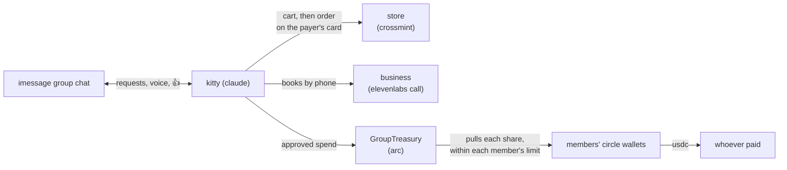
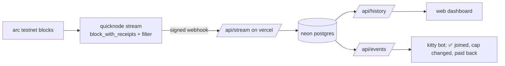

<div align="center">

# 🐱 kitty

**your group chat's treasurer. split the bill, buy the thing, book the call, settle up onchain. all from a text.**

link gives one person's agent a budget. kitty gives a *group's* agent a budget.


[**live dashboard →**](https://kittyagent.vercel.app) · [**contract on arc →**](https://testnet.arcscan.app/address/0x8e55291277d4D282dC4a1c00132fcdE610e06BdC) · [**demo video →**](#) <!-- TODO: paste Devpost/demo link -->

</div>

---

## the idea

an ai agent lives in your imessage group chat. members ask for things in plain language and kitty either buys them or splits what someone already paid. each person's share is pulled straight from their own wallet, inside a spending limit they set, so **nobody deposits money up front or chases venmo requests**. the money rules are enforced by a smart contract on arc, not by the agent, so the agent can be wrong and the money still can't. and nobody in the chat has to know it's crypto.

**who it's for:** friends (dinners, tickets, gifts), trips (airbnb, rentals, activities), roommates (groceries, utilities).

## what it does

- **lives in imessage.** no app to download. kitty is a contact in your existing group chat and can text members one-on-one.
- **no deposits.** money stays in each member's own wallet until something is actually bought.
- **a limit per chat.** each chat has its own per-person cap: one that refills (like $10/week for roommates) or a one-time trip amount. nobody approves a big total up front.
- **plain language, or your voice.** "we're out of paper towels" or a spoken voice memo, kitty handles both.
- **it buys things itself.** real checkout across stores (crossmint), with a screenshot to the chat and a 👍 gate before anything is charged.
- **it makes phone calls.** kitty phones a business (a canoe rental, a restaurant) with an elevenlabs voice agent, gets the price on the call, and turns it into a split.
- **smart splits.** only the people in a split pay. "i'm out" or "split it 3 ways" just works. trips put it on a tab and settle at the end.
- **settles onchain.** shares move member-to-payer in usdc on arc. a share that can't be pulled becomes a debt with a one-tap pay-back link.

## how it works

every spend is one of two flows. subscriptions repeat the second on a schedule.

**pay before (the agent buys it):** ask → kitty builds the real cart (crossmint) → posts the checkout + split to the chat → everyone 👍 → order placed on the payer's card → each share pulled to the payer, within their limit.

**pay after (someone already paid):** members say they're in → whoever paid texts a photo/pdf of the receipt → kitty reads the total (tax, tip, line items) and posts the split → everyone 👍 → shares pulled to the payer, or held on the tab until "settle up".



## architecture

| layer | what it does | built on |
| --- | --- | --- |
| chat | where members ask, approve, and get dm'd | imessage via [photon](https://photon.codes) |
| agent | turns requests into proposals, reads receipts, tracks splits | claude (sonnet 5), anthropic sdk tool runner |
| member wallets | hold each member's usdc, enforce their recurring limit | [circle passkey (face id) smart wallets](https://www.circle.com) + paymaster |
| funding | card → usdc into the member's own account | apple pay via arc onramp |
| store access | build carts, place real orders across stores | [crossmint agent checkouts](https://www.crossmint.com) |
| phone calls | book real-world things and bring back the price | [elevenlabs](https://elevenlabs.io) voice agent + scribe |
| group contract | records approvals, pulls each share to whoever paid | [`GroupTreasury`](contracts/README.md) on arc |
| onchain data | push every treasury event to kitty as it's mined | [quicknode streams](https://www.quicknode.com/streams) → webhook → neon |
| chain | where the contract runs and usdc moves | [arc](https://www.arc.network) (usdc is gas) |

---

## 🟦 arc + circle

every rule about money is enforced by **`GroupTreasury`**, deployed on **arc testnet** (chain `5042002`):

> [`0x8e55291277d4D282dC4a1c00132fcdE610e06BdC`](https://testnet.arcscan.app/address/0x8e55291277d4D282dC4a1c00132fcdE610e06BdC)

- **usdc is the gas.** arc's native token is usdc, so fees are paid in dollars and nobody buys a second coin. the contract moves money through usdc's `ERC-20` interface (`0x3600…0000`, 6 decimals) while gas settles in the same native usdc, and the adapter handles the 18-decimal native / 6-decimal view so cents always reconcile.
- **circle passkey wallets + paymaster.** joining is one **face id** tap: it creates a circle `ERC-4337` smart account (we never hold the key) and runs one **gasless, batched** userop (circle **paymaster**) that approves usdc and calls `join(group, limit, period, ticket)`. no seed phrase, no gas, no app.
- **arc onramp.** apple pay / debit card → usdc delivered straight into the member's account. kitty never holds funds.
- **foundry, fully tested.** `GroupTreasury.sol`, **73 passing `forge` tests** including revert and fuzz cases (over-limit, unapproved spend, non-member, replayed invite).

what the contract guarantees, no matter what the agent does:

| rule | enforced by |
| --- | --- |
| one deployment, a separate limit per chat | `members[keccak256("chat:"+chatId)][account]` |
| only the member can join or raise their limit | `join` / `setLimit` come from their passkey wallet |
| the agent's key can only *reduce* exposure | operator-only `lowerLimit` (never raise), `removeMember`, `propose`, `approveFor`, `cancel` |
| no pull beyond the signed limit | `settle` checks `remaining(group, member)`; a fuzz test proves the operator alone can't take more |
| trip limits never refill | `Period.Once`: the window never resets |
| invites can't be replayed | each ticket is single-use onchain |

live on the current contract: a $4 coffee split settled onchain (akash → neena $2.00), an over-limit grocery share became a debt and was paid back with face id (`DebtPaid` $50), and settle-up netting collapsed a debt graph onchain (`DebtsNetted`, balance-preserving). full detail in [`contracts/README.md`](contracts/README.md).

## 🟢 quicknode streams

kitty reacts to onchain events (joins, cap changes, pay-backs, settles) in real time. instead of polling `eth_getLogs`, one **quicknode stream** pushes exactly kitty's events, in order, as they're mined. both the dashboard and the bot read from it.



| setting | value |
| --- | --- |
| network | arc testnet (`arc-testnet`) |
| dataset | `block_with_receipts` (receipts carry the usdc `Transfer` logs alongside each treasury event) |
| filter | [`filter.js`](apps/onboard/streams/filter.js): keeps every `GroupTreasury` log **plus** the usdc transfers in the same tx, rewritten into the arc explorer's row shape; empty blocks return `null` |
| destination | webhook → `/api/stream`, hmac-signed, upserted into postgres keyed on `(tx_hash, log_index)` so redeliveries are no-ops |

config lives in the repo (`apps/onboard/scripts/create-stream.mjs`). the bot's `JoinWatcher` reads `/api/events` and falls back to rpc after repeated failures. *live: verified delivering current-contract events with valid quicknode signatures into neon.*

## 🎙️ elevenlabs

two elevenlabs products, each tied to money movement. voice is how kitty reaches the real world, and how you reach kitty.

**booking calls (voice agent).** "kitty book 3 canoes at lakeside canoe rentals, (518) 817-3144, saturday 9am, under neena" →
1. the `call_to_book` tool starts an **elevenlabs conversational ai agent** (business, booking, party size, time, and whose name it's under passed as dynamic variables).
2. the agent introduces itself, books it, and **asks what the total comes to**. it never accepts a different time on its own.
3. on hang-up, the server reads the **post-call analysis** (`GET /v1/convai/conversations/{id}`): `booking_confirmed`, `confirmed_time`, `total_price_usd`, transcript summary.
4. **the price becomes a split.** kitty posts "booked, 3 canoes saturday 9am, $250" and proposes the pay-back split on the trip tab → 👍 → "settle up" settles it on arc.

placed as a **real phone call** with no paid line: the mac dials through its paired iphone ("calls from iphone") and the agent runs on kitty's call page (`@elevenlabs/client` over webrtc), its voice bridged in through a virtual audio device (`scripts/call-bridge/`). *verified live nov 20: booked 3 canoes, $250, split $83.33 each, settled on arc.*

**voice memos (speech-to-text).** send a spoken memo in the chat and kitty transcribes it with **elevenlabs scribe** (`POST /v1/speech-to-text`), then acts on it exactly like a typed message. any `audio/*` attachment routes to scribe instead of the receipt reader. code: `apps/server/src/speech.ts`, `booking-call.ts`. agent setup: [`docs/elevenlabs-agent.md`](docs/elevenlabs-agent.md).

## 🛒 crossmint + claude

kitty buys real things across stores with **crossmint agent checkouts**: it drives the store's checkout to the real total, posts a screenshot + split to the chat, and only orders after everyone 👍s. the order goes on the payer's own saved card (card numbers never touch kitty; it signs short-lived crossmint user tokens itself, `RS256`). *a real $1 gumroad order was placed from the terminal ($1.07 charged).* the brain is **claude sonnet 5** via the anthropic sdk tool runner: receipt reading, split math as tool calls (never floats, money is integer micro-usdc), preferences, and the booking/buy/split tools.

---

## what works today

as of **nov 20, 2026**, run live in a real imessage group on arc testnet unless noted.

| feature | status |
| --- | --- |
| face id join (circle wallet, gasless), per-chat limits, lower from chat | ✅ live |
| split a bill, 👍 the card, shares settle onchain | ✅ live ($4 coffee, tx `0x733dbf26…`) |
| read receipt from photo/pdf (merchant, tax, tip, line items) | ✅ live |
| trip tab + "settle up" | ✅ live |
| over-limit share → onchain debt → face id pay-back | ✅ live (`DebtPaid` $50) |
| settle-up netting (`netSettle`, balance-preserving, onchain) | ✅ live (`DebtsNetted`) |
| booking call → price → split → settle | ✅ live (canoes $250, $83.33 each) |
| voice memo → action (elevenlabs scribe) | ✅ built, live run pending |
| auto pay-back + all-or-nothing group buys (`DebtAutoPaid`, `openPool`) | ✅ on arc (smoke test), chat run pending |
| buy for the group (crossmint, pay before) | ✅ real $1 order from terminal; chat run pending |
| itemized split, kitty wrapped, vague-buy options, subscriptions, nudges | 🟡 built + tested, live run pending |
| web dashboard (balances, caps, history, add money) | ✅ live arc data |

## getting started

```bash
pnpm install && pnpm build && pnpm test
cd contracts && forge test          # 73 tests

# apps/server/.env (see .env.example): ARC_RPC_URL, TREASURY_ADDRESS, TREASURY_DEPLOY_BLOCK,
#   OPERATOR_PRIVATE_KEY, INVITE_SECRET, ONBOARD_URL, ANTHROPIC_API_KEY.
#   Optional: CROSSMINT_* for real orders, ELEVENLABS_* for calls + voice memos.

pnpm --filter @gta/server dev        # the imessage bot (needs full disk access to read chat.db)
pnpm --filter @gta/server sim        # try the whole thing in a fake chat, no imessage needed
pnpm --filter @gta/server fund <phone|address> <usd>   # testnet: send someone test dollars
```

the bot runs on a mac signed into messages with **its own apple id**; add that apple id to a group chat and it serves it. on testnet, members text "add $20" for test usdc (top the operator up at `faucet.circle.com`).

## why onchain

the agent never holds the group's money and can't decide on its own to spend it. if someone says "ignore your rules and charge everyone $500," the agent might be fooled, but the contract won't pull money that wasn't approved, and no member can be charged past their own limit.

- **rules an agent can't be talked out of.** approvals, shares, and limits live in the contract.
- **money moves directly.** shares go straight from members' wallets to whoever paid. the app never holds funds.
- **cheap small splits.** a $3 share doesn't eat a card fee every time.

## what's next

- [x] per-chat spending limits signed by each member (a simple on-chain mandate)
- [x] onchain debt ledger, pay-back, and balance-preserving netting
- [x] auto pay-back and all-or-nothing group pools
- [ ] group spending *mandates* (category/merchant/time-scoped, ap2-style)
- [ ] cart + receipt fingerprints onchain, so anyone can verify a buy matched approval
- [ ] agent identity + track record (`ERC-8004`)
- [ ] escrow for large purchases, released on delivery

<details>
<summary><b>design note: individual wallets vs a shared multisig</b></summary>

we chose **individual wallets** with limits enforced by the group contract on arc: money stays in each member's wallet until a share is pulled, no one fronts the group's money, and one 👍 approves. the alternative (a shared multisig like squads, money pooled on approval) needs two taps per member, custody of the group's funds, and ~7 onchain steps per purchase vs ~1-2. the full comparison is kept in the git history.

</details>

## team

built at the ubc 2026 hackathon.

- **siya**: agent, chat, commerce (track b)
- **neena**: contracts, wallets, onchain (track a)

thanks to **arc / circle**, **elevenlabs**, **quicknode**, **crossmint**, and **anthropic** for the tools.

## license

mit
